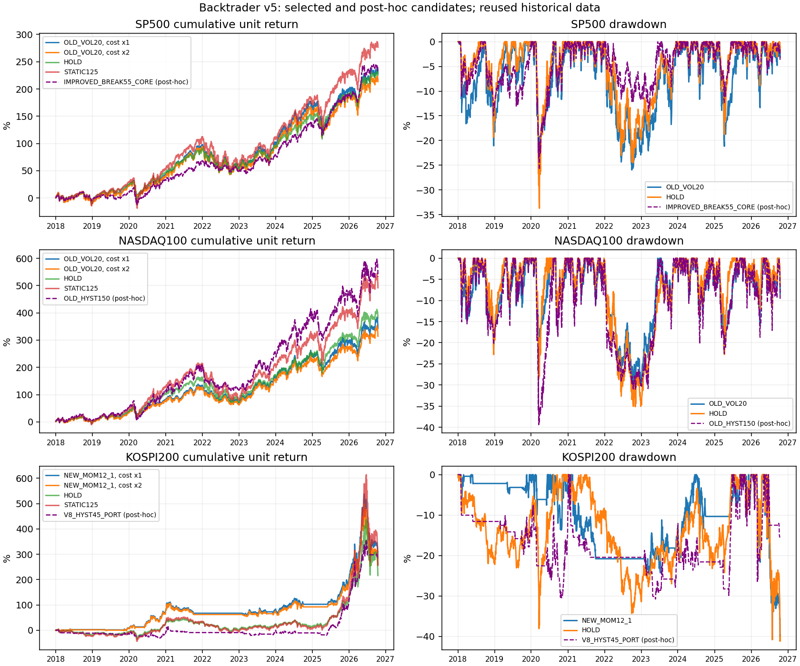

# GitHub 공개 엔진을 사용한 기존·신규·보완 전략 비교 v5

**실행 완료: Backtrader 180회 + 별도 원장 180회 대조, 기간별 결과 720개. 최대 자산금액 상대 오차 8.62e-15.**

개발구간 선택 모델: {'SP500': 'OLD_VOL20', 'NASDAQ100': 'OLD_VOL20', 'KOSPI200': 'NEW_MOM12_1'}. 연구 게이트 통과 시장: 없음. 실제 증권사 주문은 연결/활성화하지 않았다.

## 무엇을 실제로 사용했나

GitHub 공개 프로그램 **mementum/backtrader 1.9.78.123**을 설치해 다종목 주문·수수료·현금을 계산했다. 별도의 NumPy 원장으로 같은 가격과 주문 규칙을 재실행하여 매일 자산 금액을 대조했다. 이는 체결·회계 구현의 일치 확인이며 전략의 미래 수익 보증은 아니다. 다른 도구의 데모 수익률을 가져오거나 공개 엔진이 수익을 보장한다고 해석하지 않는다.

기존 저장소 `scripts/trend_refined_v8.py`의 `enrich`, `regime`, `target`을 직접 호출해 HYST45 목표 비중을 재사용했다. 기존 V8 전체 시뮬레이터의 쿨다운·손절·거래 반올림은 이식하지 않았으므로 **V8_HYST45_PORT는 목표 비중만 재사용한 변형**이다. 이전 20일 돌파·모멘텀 스윙도 종가 확인·다음 시가 체결 변형이며 이전 장중 손절 결과와 동일하지 않다.

## 개발 선택과 평가 방식

2018–2021 개발, 2022–2023 재사용 검증, 2024–2026-10-16 재사용 최종평가. 각 후보를 일시금/월납입 × 비용 1/2배에서 실행하고, 개발구간의 `CAGR / max(|MDD|,2%)` 중 최악값이 가장 높은 후보를 선택했다. 보유·2배보유·고정1.25배는 비교군이어서 선택에서 제외했다. 기간을 나눴지만 이미 여러 번 연구한 역사 자료여서 독립적인 미사용 검증은 아니다.

운용은 2018년부터 연속된다. 검증/최종평가 표는 당시 보유 포지션·자산을 이어받은 부분기간 수익이다. 매 구간을 동일 자금의 현금에서 새로 시작한 실험과 다르다. 월납입은 미국 최초10만달러+월1천달러, 국내 최초1억원+월100만원이다. 월 첫 공통 관측일 시가에 입금한다. 원화/달러 환산은 하지 않았다.

## 최종평가: 개발 선택 모델과 비교군 (기본 비용)

CAGR는 현금 입금 영향을 제거한 시가 단위기준가의 연복리, XIRR는 납입 시점을 반영한 금액가중 연수익률, MDD는 단위기준가 최대낙폭이다. 레버리지는 실제 2배 ETF 가격을 썼다. 일반 ETF보다 더 큰 위험 노출이므로 수익 증가가 곧 초과수익 창출 능력을 뜻하지 않는다.

| case | strategy | funding | cagr | xirr | mdd | avg_exposure |
|---|---|---|---|---|---|---|
| SP500 | HOLD | lump | 19.81% | 19.81% | -18.76% | 100.00% |
| SP500 | HOLD | monthly | 19.81% | 19.74% | -18.76% | 100.00% |
| SP500 | LEV2_HOLD | lump | 32.06% | 32.06% | -35.21% | 100.00% |
| SP500 | LEV2_HOLD | monthly | 32.06% | 31.95% | -35.21% | 100.00% |
| SP500 | STATIC125 | lump | 22.91% | 22.91% | -23.09% | 100.00% |
| SP500 | STATIC125 | monthly | 22.90% | 22.82% | -23.09% | 100.00% |
| SP500 | OLD_VOL20 | lump | 18.86% | 18.86% | -21.17% | 100.00% |
| SP500 | OLD_VOL20 | monthly | 18.86% | 18.74% | -21.17% | 100.00% |
| NASDAQ100 | HOLD | lump | 22.35% | 22.35% | -22.77% | 100.00% |
| NASDAQ100 | HOLD | monthly | 22.35% | 22.33% | -22.77% | 100.00% |
| NASDAQ100 | LEV2_HOLD | lump | 35.13% | 35.13% | -42.29% | 100.00% |
| NASDAQ100 | LEV2_HOLD | monthly | 35.13% | 35.11% | -42.29% | 100.00% |
| NASDAQ100 | STATIC125 | lump | 25.75% | 25.75% | -27.88% | 100.00% |
| NASDAQ100 | STATIC125 | monthly | 25.75% | 25.73% | -27.88% | 100.00% |
| NASDAQ100 | OLD_VOL20 | lump | 19.70% | 19.70% | -22.31% | 100.00% |
| NASDAQ100 | OLD_VOL20 | monthly | 19.70% | 19.67% | -22.31% | 100.00% |
| KOSPI200 | HOLD | lump | 40.37% | 40.37% | -41.22% | 100.00% |
| KOSPI200 | HOLD | monthly | 40.36% | 41.29% | -41.22% | 100.00% |
| KOSPI200 | LEV2_HOLD | lump | 60.53% | 60.53% | -71.64% | 100.00% |
| KOSPI200 | LEV2_HOLD | monthly | 60.52% | 62.39% | -71.64% | 100.00% |
| KOSPI200 | STATIC125 | lump | 47.89% | 47.89% | -50.06% | 100.00% |
| KOSPI200 | STATIC125 | monthly | 47.89% | 49.08% | -50.06% | 100.00% |
| KOSPI200 | NEW_MOM12_1 | lump | 30.42% | 30.42% | -40.81% | 70.38% |
| KOSPI200 | NEW_MOM12_1 | monthly | 30.42% | 30.64% | -40.81% | 70.38% |

## 사후 탐색 후 추가 확인한 후보 — 개발 선택 모델과 구분

재사용 검증/최종평가 × 비용1/2배 × 일시금/월납입의 8조건 전부에서 지수보다 수익률과 낙폭이 함께 개선되고 수익률이 양수인 후보를 전체 후보에서 기계적으로 찾았다. 그런 다음 1거래일 추가 지연을 확인했다. **평가 결과를 본 뒤 골랐으므로 독립 미사용 검증이나 개발 선택 성공으로 간주하지 않는다.**

- SP500 / IMPROVED_BREAK55_CORE: 기본 8/8 통과, 추가 지연 8조건 모두 통과=False, 3개월 블록 재표본의 초과수익 95%구간=[-0.01235940398017984, 0.12090476708777544], 사후 연구 게이트=False.

- NASDAQ100 / OLD_HYST150: 기본 8/8 통과, 추가 지연 8조건 모두 통과=False, 3개월 블록 재표본의 초과수익 95%구간=[-0.07154376353386499, 0.10902587720091446], 사후 연구 게이트=False.

- KOSPI200 / V8_HYST45_PORT: 기본 8/8 통과, 추가 지연 8조건 모두 통과=False, 3개월 블록 재표본의 초과수익 95%구간=[-0.23460761653974507, 0.8451674335337144], 사후 연구 게이트=False.

| case | strategy | stage | cost | funding | cagr | xirr | mdd |
|---|---|---|---|---|---|---|---|
| SP500 | IMPROVED_BREAK55_CORE | primary | 1 | lump | 24.65% | 24.65% | -12.51% |
| SP500 | IMPROVED_BREAK55_CORE | primary | 1 | monthly | 24.65% | 24.54% | -12.51% |
| SP500 | IMPROVED_BREAK55_CORE | primary | 2 | lump | 22.16% | 22.16% | -12.76% |
| SP500 | IMPROVED_BREAK55_CORE | primary | 2 | monthly | 22.16% | 22.05% | -12.76% |
| NASDAQ100 | OLD_HYST150 | primary | 1 | lump | 22.84% | 22.84% | -22.61% |
| NASDAQ100 | OLD_HYST150 | primary | 1 | monthly | 22.84% | 22.77% | -22.61% |
| NASDAQ100 | OLD_HYST150 | primary | 2 | lump | 22.70% | 22.70% | -22.66% |
| NASDAQ100 | OLD_HYST150 | primary | 2 | monthly | 22.70% | 22.63% | -22.66% |
| KOSPI200 | V8_HYST45_PORT | primary | 1 | lump | 63.79% | 63.79% | -26.71% |
| KOSPI200 | V8_HYST45_PORT | primary | 1 | monthly | 63.79% | 66.28% | -26.71% |
| KOSPI200 | V8_HYST45_PORT | primary | 2 | lump | 60.17% | 60.17% | -26.79% |
| KOSPI200 | V8_HYST45_PORT | primary | 2 | monthly | 60.17% | 62.90% | -26.79% |
| SP500 | IMPROVED_BREAK55_CORE | posthoc_delay | 1 | lump | 25.51% | 25.51% | -14.17% |
| SP500 | IMPROVED_BREAK55_CORE | posthoc_delay | 1 | monthly | 25.51% | 25.40% | -14.17% |
| SP500 | IMPROVED_BREAK55_CORE | posthoc_delay | 2 | lump | 23.01% | 23.01% | -14.41% |
| SP500 | IMPROVED_BREAK55_CORE | posthoc_delay | 2 | monthly | 23.01% | 22.91% | -14.41% |
| NASDAQ100 | OLD_HYST150 | posthoc_delay | 1 | lump | 22.80% | 22.80% | -23.07% |
| NASDAQ100 | OLD_HYST150 | posthoc_delay | 1 | monthly | 22.80% | 22.73% | -23.07% |
| NASDAQ100 | OLD_HYST150 | posthoc_delay | 2 | lump | 22.66% | 22.66% | -23.13% |
| NASDAQ100 | OLD_HYST150 | posthoc_delay | 2 | monthly | 22.66% | 22.59% | -23.13% |
| KOSPI200 | V8_HYST45_PORT | posthoc_delay | 1 | lump | 48.39% | 48.39% | -26.22% |
| KOSPI200 | V8_HYST45_PORT | posthoc_delay | 1 | monthly | 48.40% | 50.74% | -26.22% |
| KOSPI200 | V8_HYST45_PORT | posthoc_delay | 2 | lump | 45.10% | 45.10% | -28.41% |
| KOSPI200 | V8_HYST45_PORT | posthoc_delay | 2 | monthly | 45.11% | 47.68% | -28.40% |

## 보완 전후 비교: 사후 최고 수익만 골라 표시하지 않음

아래는 미리 정한 대응 후보 전부다. 현금 비중을 줄인 보완안은 투자 노출과 위험이 같이 커질 수 있다. 다른 진입·청산 규칙이 포함되어 특정 수정 한 가지의 효과를 분리한 실험은 아니다.

| case | strategy | cagr | mdd | avg_exposure |
|---|---|---|---|---|
| SP500 | OLD_VOL20 | 18.86% | -21.17% | 100.00% |
| SP500 | NEW_TREND_ENSEMBLE | 19.64% | -16.06% | 100.00% |
| SP500 | NEW_MOM12_1 | 20.38% | -18.33% | 91.01% |
| SP500 | OLD_MOM60_PORT | 9.06% | -6.25% | 26.11% |
| SP500 | OLD_BREAK20_CLOSE_PORT | 5.39% | -3.03% | 25.68% |
| SP500 | IMPROVED_MOM_CORE | 17.05% | -16.12% | 95.56% |
| SP500 | IMPROVED_BREAK55_CORE | 24.65% | -12.51% | 96.12% |
| SP500 | NEW_CORE_ENSEMBLE | 20.40% | -16.54% | 97.23% |
| NASDAQ100 | OLD_VOL20 | 19.70% | -22.31% | 100.00% |
| NASDAQ100 | NEW_TREND_ENSEMBLE | 20.84% | -19.14% | 100.00% |
| NASDAQ100 | NEW_CORE_ENSEMBLE | 21.68% | -18.16% | 97.16% |
| KOSPI200 | OLD_VOL20 | 31.53% | -28.03% | 78.13% |
| KOSPI200 | NEW_TREND_ENSEMBLE | 34.26% | -26.05% | 73.12% |
| KOSPI200 | NEW_MOM12_1 | 30.42% | -40.81% | 70.38% |
| KOSPI200 | OLD_MOM60_PORT | 7.16% | -3.83% | 13.82% |
| KOSPI200 | OLD_BREAK20_CLOSE_PORT | 6.48% | -3.39% | 7.75% |
| KOSPI200 | IMPROVED_MOM_CORE | 36.74% | -40.41% | 88.28% |
| KOSPI200 | IMPROVED_BREAK55_CORE | 36.60% | -41.05% | 88.51% |
| KOSPI200 | NEW_CORE_ENSEMBLE | 35.22% | -33.24% | 84.92% |
| KOSPI200 | V8_HYST45_PORT | 63.79% | -26.71% | 40.95% |

## 선택 후보의 비용·체결 지연 스트레스

기본은 완료 종가 신호의 다음 공통 관측 시가, 지연 스트레스는 그 다음 시가다. 비용2는 기본 편도 비용의 두 배다. 적립식 비교에서는 CAGR 대신 XIRR도 함께 확인해야 한다.

| case | strategy | window | stage | cost | funding | cagr | xirr | mdd |
|---|---|---|---|---|---|---|---|---|
| SP500 | HOLD | validation_reused | primary | 1 | lump | 1.61% | 1.61% | -24.50% |
| SP500 | HOLD | test_reused | primary | 1 | lump | 19.81% | 19.81% | -18.76% |
| SP500 | HOLD | validation_reused | primary | 1 | monthly | 1.61% | 2.22% | -24.50% |
| SP500 | HOLD | test_reused | primary | 1 | monthly | 19.81% | 19.74% | -18.76% |
| SP500 | HOLD | validation_reused | primary | 2 | lump | 1.61% | 1.61% | -24.50% |
| SP500 | HOLD | test_reused | primary | 2 | lump | 19.81% | 19.81% | -18.76% |
| SP500 | HOLD | validation_reused | primary | 2 | monthly | 1.61% | 2.22% | -24.50% |
| SP500 | HOLD | test_reused | primary | 2 | monthly | 19.81% | 19.74% | -18.76% |
| SP500 | OLD_VOL20 | validation_reused | primary | 1 | lump | 1.37% | 1.37% | -25.96% |
| SP500 | OLD_VOL20 | test_reused | primary | 1 | lump | 18.86% | 18.86% | -21.17% |
| SP500 | OLD_VOL20 | validation_reused | primary | 1 | monthly | 1.37% | 2.09% | -25.96% |
| SP500 | OLD_VOL20 | test_reused | primary | 1 | monthly | 18.86% | 18.74% | -21.17% |
| SP500 | OLD_VOL20 | validation_reused | primary | 2 | lump | 0.74% | 0.74% | -26.42% |
| SP500 | OLD_VOL20 | test_reused | primary | 2 | lump | 18.35% | 18.35% | -21.35% |
| SP500 | OLD_VOL20 | validation_reused | primary | 2 | monthly | 0.74% | 1.48% | -26.42% |
| SP500 | OLD_VOL20 | test_reused | primary | 2 | monthly | 18.35% | 18.23% | -21.35% |
| SP500 | OLD_VOL20 | validation_reused | delay_stress | 1 | lump | 0.97% | 0.97% | -25.65% |
| SP500 | OLD_VOL20 | test_reused | delay_stress | 1 | lump | 18.47% | 18.47% | -21.29% |
| SP500 | OLD_VOL20 | validation_reused | delay_stress | 1 | monthly | 0.97% | 1.68% | -25.65% |
| SP500 | OLD_VOL20 | test_reused | delay_stress | 1 | monthly | 18.47% | 18.35% | -21.29% |
| SP500 | OLD_VOL20 | validation_reused | delay_stress | 2 | lump | 0.34% | 0.34% | -26.13% |
| SP500 | OLD_VOL20 | test_reused | delay_stress | 2 | lump | 17.96% | 17.96% | -21.40% |
| SP500 | OLD_VOL20 | validation_reused | delay_stress | 2 | monthly | 0.34% | 1.07% | -26.13% |
| SP500 | OLD_VOL20 | test_reused | delay_stress | 2 | monthly | 17.96% | 17.83% | -21.40% |
| SP500 | HOLD | validation_reused | delay_stress | 1 | lump | 1.61% | 1.61% | -24.50% |
| SP500 | HOLD | test_reused | delay_stress | 1 | lump | 19.81% | 19.81% | -18.76% |
| SP500 | HOLD | validation_reused | delay_stress | 1 | monthly | 1.61% | 2.22% | -24.50% |
| SP500 | HOLD | test_reused | delay_stress | 1 | monthly | 19.81% | 19.74% | -18.76% |
| SP500 | HOLD | validation_reused | delay_stress | 2 | lump | 1.61% | 1.61% | -24.50% |
| SP500 | HOLD | test_reused | delay_stress | 2 | lump | 19.81% | 19.81% | -18.76% |
| SP500 | HOLD | validation_reused | delay_stress | 2 | monthly | 1.61% | 2.22% | -24.50% |
| SP500 | HOLD | test_reused | delay_stress | 2 | monthly | 19.81% | 19.74% | -18.76% |
| NASDAQ100 | HOLD | validation_reused | primary | 1 | lump | 2.19% | 2.19% | -34.83% |
| NASDAQ100 | HOLD | test_reused | primary | 1 | lump | 22.35% | 22.35% | -22.77% |
| NASDAQ100 | HOLD | validation_reused | primary | 1 | monthly | 2.19% | 3.00% | -34.83% |
| NASDAQ100 | HOLD | test_reused | primary | 1 | monthly | 22.35% | 22.33% | -22.77% |
| NASDAQ100 | HOLD | validation_reused | primary | 2 | lump | 2.19% | 2.19% | -34.83% |
| NASDAQ100 | HOLD | test_reused | primary | 2 | lump | 22.35% | 22.35% | -22.77% |
| NASDAQ100 | HOLD | validation_reused | primary | 2 | monthly | 2.18% | 3.00% | -34.83% |
| NASDAQ100 | HOLD | test_reused | primary | 2 | monthly | 22.34% | 22.33% | -22.77% |
| NASDAQ100 | OLD_VOL20 | validation_reused | primary | 1 | lump | 7.45% | 7.45% | -28.29% |
| NASDAQ100 | OLD_VOL20 | test_reused | primary | 1 | lump | 19.70% | 19.70% | -22.31% |
| NASDAQ100 | OLD_VOL20 | validation_reused | primary | 1 | monthly | 7.45% | 8.28% | -28.29% |
| NASDAQ100 | OLD_VOL20 | test_reused | primary | 1 | monthly | 19.70% | 19.67% | -22.31% |
| NASDAQ100 | OLD_VOL20 | validation_reused | primary | 2 | lump | 6.71% | 6.71% | -28.64% |
| NASDAQ100 | OLD_VOL20 | test_reused | primary | 2 | lump | 18.67% | 18.67% | -22.56% |
| NASDAQ100 | OLD_VOL20 | validation_reused | primary | 2 | monthly | 6.71% | 7.55% | -28.64% |
| NASDAQ100 | OLD_VOL20 | test_reused | primary | 2 | monthly | 18.67% | 18.64% | -22.56% |
| NASDAQ100 | OLD_VOL20 | validation_reused | delay_stress | 1 | lump | 7.91% | 7.91% | -27.75% |
| NASDAQ100 | OLD_VOL20 | test_reused | delay_stress | 1 | lump | 19.83% | 19.83% | -21.91% |
| NASDAQ100 | OLD_VOL20 | validation_reused | delay_stress | 1 | monthly | 7.91% | 8.73% | -27.75% |
| NASDAQ100 | OLD_VOL20 | test_reused | delay_stress | 1 | monthly | 19.83% | 19.81% | -21.91% |
| NASDAQ100 | OLD_VOL20 | validation_reused | delay_stress | 2 | lump | 7.16% | 7.16% | -28.10% |
| NASDAQ100 | OLD_VOL20 | test_reused | delay_stress | 2 | lump | 18.80% | 18.80% | -22.16% |
| NASDAQ100 | OLD_VOL20 | validation_reused | delay_stress | 2 | monthly | 7.16% | 8.00% | -28.10% |
| NASDAQ100 | OLD_VOL20 | test_reused | delay_stress | 2 | monthly | 18.80% | 18.78% | -22.16% |
| NASDAQ100 | HOLD | validation_reused | delay_stress | 1 | lump | 2.19% | 2.19% | -34.83% |
| NASDAQ100 | HOLD | test_reused | delay_stress | 1 | lump | 22.35% | 22.35% | -22.77% |
| NASDAQ100 | HOLD | validation_reused | delay_stress | 1 | monthly | 2.19% | 3.00% | -34.83% |
| NASDAQ100 | HOLD | test_reused | delay_stress | 1 | monthly | 22.35% | 22.33% | -22.77% |
| NASDAQ100 | HOLD | validation_reused | delay_stress | 2 | lump | 2.19% | 2.19% | -34.83% |
| NASDAQ100 | HOLD | test_reused | delay_stress | 2 | lump | 22.35% | 22.35% | -22.77% |
| NASDAQ100 | HOLD | validation_reused | delay_stress | 2 | monthly | 2.18% | 3.00% | -34.83% |
| NASDAQ100 | HOLD | test_reused | delay_stress | 2 | monthly | 22.34% | 22.33% | -22.77% |
| KOSPI200 | HOLD | validation_reused | primary | 1 | lump | -2.69% | -2.69% | -27.96% |
| KOSPI200 | HOLD | test_reused | primary | 1 | lump | 40.37% | 40.37% | -41.22% |
| KOSPI200 | HOLD | validation_reused | primary | 1 | monthly | -2.70% | -1.87% | -27.96% |
| KOSPI200 | HOLD | test_reused | primary | 1 | monthly | 40.36% | 41.29% | -41.22% |
| KOSPI200 | HOLD | validation_reused | primary | 2 | lump | -2.69% | -2.69% | -27.96% |
| KOSPI200 | HOLD | test_reused | primary | 2 | lump | 40.37% | 40.37% | -41.22% |
| KOSPI200 | HOLD | validation_reused | primary | 2 | monthly | -2.71% | -1.88% | -27.97% |
| KOSPI200 | HOLD | test_reused | primary | 2 | monthly | 40.35% | 41.28% | -41.22% |
| KOSPI200 | NEW_MOM12_1 | validation_reused | primary | 1 | lump | 4.65% | 4.65% | -11.54% |
| KOSPI200 | NEW_MOM12_1 | test_reused | primary | 1 | lump | 30.42% | 30.42% | -40.81% |
| KOSPI200 | NEW_MOM12_1 | validation_reused | primary | 1 | monthly | 4.65% | 4.83% | -11.54% |
| KOSPI200 | NEW_MOM12_1 | test_reused | primary | 1 | monthly | 30.42% | 30.64% | -40.81% |
| KOSPI200 | NEW_MOM12_1 | validation_reused | primary | 2 | lump | 3.95% | 3.95% | -11.82% |
| KOSPI200 | NEW_MOM12_1 | test_reused | primary | 2 | lump | 29.23% | 29.23% | -40.97% |
| KOSPI200 | NEW_MOM12_1 | validation_reused | primary | 2 | monthly | 3.96% | 4.11% | -11.82% |
| KOSPI200 | NEW_MOM12_1 | test_reused | primary | 2 | monthly | 29.24% | 29.46% | -40.97% |
| KOSPI200 | NEW_MOM12_1 | validation_reused | delay_stress | 1 | lump | 4.86% | 4.86% | -11.07% |
| KOSPI200 | NEW_MOM12_1 | test_reused | delay_stress | 1 | lump | 30.18% | 30.18% | -40.62% |
| KOSPI200 | NEW_MOM12_1 | validation_reused | delay_stress | 1 | monthly | 4.86% | 5.04% | -11.07% |
| KOSPI200 | NEW_MOM12_1 | test_reused | delay_stress | 1 | monthly | 30.18% | 30.37% | -40.62% |
| KOSPI200 | NEW_MOM12_1 | validation_reused | delay_stress | 2 | lump | 4.16% | 4.16% | -11.36% |
| KOSPI200 | NEW_MOM12_1 | test_reused | delay_stress | 2 | lump | 28.98% | 28.98% | -40.80% |
| KOSPI200 | NEW_MOM12_1 | validation_reused | delay_stress | 2 | monthly | 4.16% | 4.32% | -11.36% |
| KOSPI200 | NEW_MOM12_1 | test_reused | delay_stress | 2 | monthly | 28.99% | 29.18% | -40.80% |
| KOSPI200 | HOLD | validation_reused | delay_stress | 1 | lump | -2.69% | -2.69% | -27.96% |
| KOSPI200 | HOLD | test_reused | delay_stress | 1 | lump | 40.37% | 40.37% | -41.22% |
| KOSPI200 | HOLD | validation_reused | delay_stress | 1 | monthly | -2.70% | -1.87% | -27.96% |
| KOSPI200 | HOLD | test_reused | delay_stress | 1 | monthly | 40.36% | 41.29% | -41.22% |
| KOSPI200 | HOLD | validation_reused | delay_stress | 2 | lump | -2.69% | -2.69% | -27.96% |
| KOSPI200 | HOLD | test_reused | delay_stress | 2 | lump | 40.37% | 40.37% | -41.22% |
| KOSPI200 | HOLD | validation_reused | delay_stress | 2 | monthly | -2.71% | -1.88% | -27.97% |
| KOSPI200 | HOLD | test_reused | delay_stress | 2 | monthly | 40.35% | 41.28% | -41.22% |

## 국내 대체 자료 민감도

주 결과는 Naver fchart 가격 자료로 현금 배당/분배금이 포함되지 않은 가격 수익률이다. 대조 자료는 기존 Yahoo 조정가격의 배당 포함 수익률 근사다. **공급원과 수익률 기준이 함께 달라지므로 순수한 공급원 효과로 해석하면 안 된다.** 국내 총수익 우월성은 이 실험만으로 확정할 수 없다.

| case | strategy | funding | cagr | xirr | mdd |
|---|---|---|---|---|---|
| KOSPI200 | HOLD | lump | 40.37% | 40.37% | -41.22% |
| KOSPI200 | HOLD | monthly | 40.36% | 41.29% | -41.22% |
| KOSPI200 | NEW_MOM12_1 | lump | 32.91% | 32.91% | -40.79% |
| KOSPI200 | NEW_MOM12_1 | monthly | 32.91% | 33.08% | -40.79% |
| KOSPI200 | OLD_HYST150 | lump | 44.53% | 44.53% | -58.05% |
| KOSPI200 | OLD_HYST150 | monthly | 44.53% | 45.92% | -58.05% |
| KOSPI200 | V8_HYST45_PORT | lump | 67.10% | 67.10% | -26.68% |
| KOSPI200 | V8_HYST45_PORT | monthly | 67.10% | 69.22% | -26.68% |

## 불확실성과 진입 제한

선택 후보가 재사용 검증/최종평가 × 두 비용 × 두 납입 × 두 체결시점 모두에서 양수, 지수보유보다 높은 CAGR(월납입은XIRR), 낮거나 같은 MDD를 충족하고 아래 블록 재표본의 95% 구간 하단도 양수여야 연구 게이트를 통과한다. 이는 원지수 HOLD 대비 조건이며 고정 레버리지 또는 전 시장 우월성을 의미하지 않는다. 통과하더라도 독립 미래 모의운용이 남는다. 국내 대체자료 표는 추가 민감도이며 이 게이트에는 포함하지 않았다.

- SP500: OLD_VOL20, 게이트 False, 최종평가 월별 수익의 3개월 블록 2,000회 재표본 기준 초과 연복리 차이 구간 [-7.91%, 6.91%].

- NASDAQ100: OLD_VOL20, 게이트 False, 최종평가 월별 수익의 3개월 블록 2,000회 재표본 기준 초과 연복리 차이 구간 [-8.76%, 4.13%].

- KOSPI200: NEW_MOM12_1, 게이트 False, 최종평가 월별 수익의 3개월 블록 2,000회 재표본 기준 초과 연복리 차이 구간 [-45.89%, 13.30%].

이 재표본 구간은 선택된 모델과 고정 종목 표본을 조건으로 한 추정이다. 반복 연구·다중 탐색·생존편향을 완전히 보정하지 못했다. 어떤 결과도 수익 보장이 아니다.

## 전략 규칙

- **HOLD**: 100% base; buy-and-hold, new deposits buy base

- **LEV2_HOLD**: 100% actual daily 2x ETF, risky reference

- **STATIC125**: 75% base +25% actual 2x ETF, monthly

- **OLD_HYST150**: 200MA +/-1%, 3 closes; exposure1.5 /0.5

- **OLD_VOL20**: min(1.5,20%/20-day annualized vol); 5pp band

- **NEW_TREND_ENSEMBLE**: mean(MA50/100/200 trend votes); exposure0.5+votes, cap by22% vol20

- **NEW_MOM12_1**: monthly top5 positive 12-1 momentum stocks above MA200, equal weights; market MA200 filter

- **OLD_MOM60_PORT**: 20-session rotation, top5 positive60d momentum above MA200, 0.25%/2ATR risk weights

- **OLD_BREAK20_CLOSE_PORT**: 20d breakout, 2ATR close trailing stop/20-session hold, risk0.25%; close-only adaptation

- **IMPROVED_MOM_CORE**: monthly top5 mean rank of 60d/126d/252d(skip21) momentum; 50% stock +50% base, cash substitutes missing stocks; bear:50% base

- **IMPROVED_BREAK55_CORE**: 55d breakout, 20d low or3ATR trailing close exits; max20-session hold; 50% base + up to50% stocks, residual in base

- **NEW_CORE_ENSEMBLE**: equal average OLD_VOL20, IMPROVED_MOM_CORE, IMPROVED_BREAK55_CORE

- **V8_HYST45_PORT**: existing scripts/trend_refined_v8.py HYST45 target; weekly plus regime changes; execution/risk wrapper replaced

OLD_MOM60_PORT는 양의 60일 수익률·200일선 위 종목 상위5개를 20개 관측 세션마다 고르고, 목표 비중은 min(20%,0.25%/(2ATR/종가))다. OLD_BREAK20_CLOSE_PORT는 같은 위험 배분과 20일 돌파를 쓴다. IMPROVED_BREAK55_CORE는 55일 돌파, 목표 비중 min(20%,0.75%/(3ATR/종가)), 종목 합계50% 상한, 나머지 원지수 배분이다. 공통 돌파 보유는 최대20개 관측 세션, 종가가 추적선/이전20일저가/200일선 아래면 다음 시가 청산한다. 장중 지정 손절은 없다.

IMPROVED_MOM_CORE는 매월 관측 시작 시점에서 직전 종가 정보로 60/126/252 관측일 모멘텀(최근21 관측일 제외) 순위 평균을 사용한다. 200일선 위·양의12-1 및60일 모멘텀 종목 최대5개에 각10%, 나머지 원지수다. 월 리밸런싱 기준 하락장에서는 원지수50%와 현금50%다. NEW_MOM12_1은 시장200일선 필터를 적용하고 최대5개 각20%, 미충족 슬롯은 현금이다.

추세 앙상블의 노출은 min(0.5+3개 이동평균 추세투표 평균,22%/20일 변동성)이다. 1초과 노출은 원지수(2-e)와 실제2배ETF(e-1), 1이하는 원지수e와 미국SHY 또는 국내현금으로 구현한다. 최대 명목노출1.5배, 직접 차입/공매도는 없다.

매월 첫 공통 관측일과 목표비중 변경일에 재조정한다. HOLD/LEV2_HOLD는 처음 진입과 새 납입금 매수만 하므로 불필요한 월 재매매를 하지 않는다. 매도 먼저, 매수는 남은 현금 내림차순 목표비중/종목코드 순서다. 매수는 직전 관측봉 거래대금의0.5% 한도다. 매도 거래량 제한은 구현하지 않았다.

## 비용·체결·자료의 중요한 한계

미국ETF 편도0.07%, 미국종목0.10%, 국내ETF0.15%, 국내종목 매수0.15%/매도0.35%를 수수료·스프레드·슬리피지·매도측 비용의 합산 가정으로 차감한다. stress=2는 각각 두 배다. 실제 세율/증권사 수수료 확정값이 아니다. 슬리피지는 시가를 바꾸지 않고 동액 비용으로 차감했다. 실제 주문장·시장충격·거래정지/VI·상하한가 미체결·개인 양도세·환전·현금 이자는 재현하지 않았다.

Backtrader cheat_on_open은 **기존 종가로 확정된 비중**을 다음 시가에 수량으로 바꾸는 데만 쓴다. 당일 고가/저가/종가로 신규 비중을 정하지 않는다. 다만 실제 시가를 확인한 뒤 같은 시가에 체결하는 것은 보장되지 않는다. 현재 비용과 1거래일 추가 지연 시험이 그 차이를 완전히 설명하지 못할 수 있다. 조정가격 소수 단위는 실제 주문가능 정수 주수/호가와 다르다.

미국은 Yahoo adjclose/close 비율을 OHLC에 적용한 기존 스냅샷, 국내 주 결과는 Naver 가격 스냅샷, 국내 대조는 Yahoo 스냅샷이다. 데이터 범위/해시는 input/manifest.json에 보관했다. 자료를 보간하지 않고 잘못된 OHLC·0거래량 봉을 삭제한 뒤 시장별 전체 종목 공통 달력만 사용했다. 따라서 어떤 한 종목의 누락/정지 때문에 시장 전체의 정상 거래일도 빠질 수 있고, 누락일의 낙폭/매매 기회를 놓친다. 이동평균·모멘텀의 일수는 이 공통 관측일 기준이다. 삭제일은 data_audit.json에 있다.

개별주식 표본은 미국20개·국내10개의 현재 생존 대형주다. 상장폐지/과거 편입종목/전체 종목 유동성 순위를 복원하지 못했고 미국 기술주 비중도 높다. 원지수 초과성과가 나와도 전 시장 종목선정 능력이 입증되는 것은 아니다. 마지막 평가일은 보유가격 평가이며 강제 청산 비용은 추가하지 않았다. 장중 손절이 없으므로 예정 위험을 넘는 손실도 가능하다.

## 재현과 자료

`research/github_lab_v5/README_KO.md`의 한 번 실행 명령 또는 GitHub Actions 실행을 사용한다. `comparison.csv`는 표 전체, `details/`는 일별 자산/현금/단위기준가와 체결내역이다. 코드는 고정 스냅샷에서 동작하며 브로커 키/주문 전송 기능이 없다.

## 공개 근거

- Backtrader 원본: https://github.com/mementum/backtrader (GPL-3.0, 실행 버전1.9.78.123)
- 시가 처리 공식 문서: https://www.backtrader.com/docu/cerebro/cheat-on-open/cheat-on-open/
- 거래비용 공식 문서: https://www.backtrader.com/docu/commission-schemes/commission-schemes/
- 모멘텀 구성 원문: https://www.aqr.com/insights/datasets/momentum-indices-monthly (12개월 중 최근1개월 제외 아이디어; AQR 자체 지수 복제가 아님)

이전 지수 장기/위기 연구(PR#3) 및 개별주식 장중손절/분봉 연구(PR#4)와 입력·현금흐름·체결규칙이 다르다. 보고서 간 수익률을 하나의 동일 전략 실적으로 합치면 안 된다. 이번 v5는 일봉 전략 비교에 집중하며 분봉 단타의 장기간 우월성은 추가 입증하지 않았다.