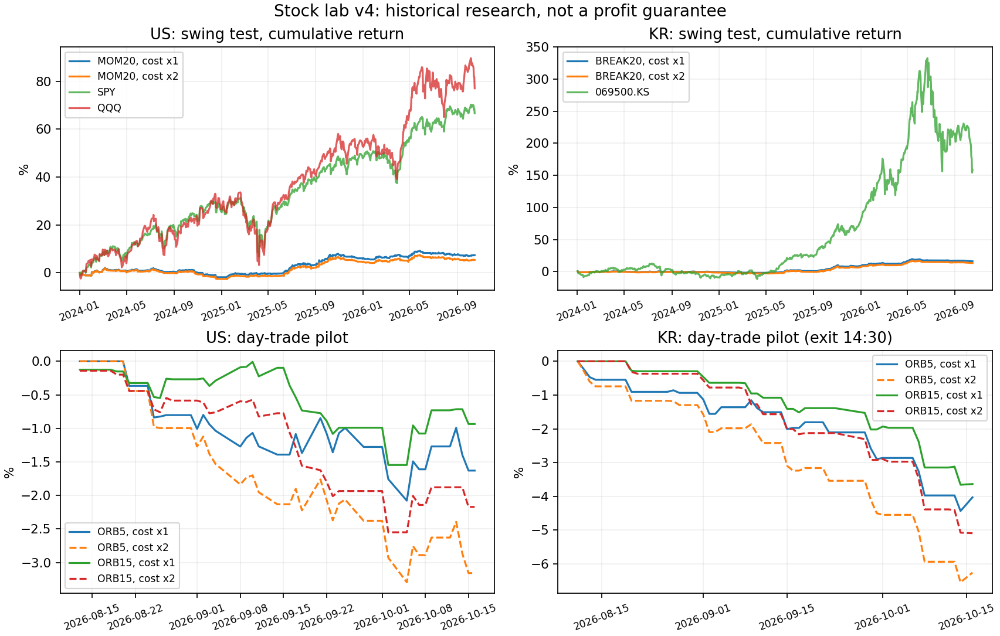

# 개별주식 단타·스윙 검증 v4

**결론: 이 표본에서는 지수 보유·정기매수 초과와 낮은 낙폭을 함께 유지하는 모델을 확보하지 못했다. 실거래는 비활성이다.**

총 232개 전략·기간·비용·납입 조합. 미국 20종목, 국내 10종목 일봉과 양국 10종목씩 실제 5분봉을 사용했다. 미국 개발 선택은 MOM20, 국내는 BREAK20다. 후보를 최종평가 성적으로 바꾸지 않았다.

## 기간과 후보 선택

개발: 2018–2021, 검증: 2022–2023, 최종평가: 2024-01-01–2026-10-16. 개발구간 기본비용·일시금 Sharpe가 가장 높은 모델을 시장별로 선택했다. 이미 알려진 과거 자료에서 한 시간순 모의검증이며, 독립적인 미래 실적은 아니다.

## 최종평가 스윙 (기본비용·일시금)

CAGR는 연복리수익률, MDD는 현금 납입 영향을 제거한 최대낙폭이다. 평균투자비중은 종가 기준이다. 지수는 사실상 100% 투자지만 종목 전략은 위험 예산 때문에 현금 비중이 높다. 낮은 낙폭만으로 초과성과를 주장하지 않는다.

| market | strategy | cagr | mdd | trades | avg_close_exposure |
|---|---|---|---|---|---|
| us | BREAK20 | 2.91% | -4.09% | 265 | 23.53% |
| us | BREAK55 | 4.26% | -4.11% | 222 | 20.45% |
| us | RSI2 | 0.43% | -3.08% | 467 | 11.65% |
| us | PULLBACK | 0.52% | -4.26% | 601 | 14.27% |
| us | MOM20 | 2.57% | -3.91% | 174 | 12.47% |
| us | SPY | 20.10% | -18.76% | 0 | nan |
| us | QQQ | 22.75% | -22.77% | 0 | nan |
| kr | BREAK20 | 5.50% | -2.90% | 116 | 6.87% |
| kr | BREAK55 | 3.65% | -2.61% | 87 | 4.94% |
| kr | RSI2 | 1.29% | -1.28% | 189 | 2.73% |
| kr | PULLBACK | 1.38% | -1.72% | 252 | 4.07% |
| kr | MOM20 | 2.65% | -3.33% | 127 | 5.71% |
| kr | 069500.KS | 40.61% | -41.22% | 0 | nan |

## 선택 모델의 시간순 평가·비용 스트레스·정기매수

monthly는 최초 투자금에 매월 1%를 추가하는 동일 납입 비교다. 미국 최초 10만 달러·월 1천 달러, 국내 최초 1억 원·월 100만 원. XIRR는 납입 시점이 반영된 금액가중수익률이다. 각 평가구간은 현금에서 새로 시작하며 첫 달 추가납입은 없다.

| market | strategy | window | stress | flow | cagr | xirr | mdd |
|---|---|---|---|---|---|---|---|
| us | MOM20 | validation | 1 | lump | -0.03% | -0.03% | -4.38% |
| us | SPY | validation | 1 | lump | 1.37% | 1.37% | -24.50% |
| us | QQQ | validation | 1 | lump | 1.94% | 1.94% | -34.83% |
| us | MOM20 | validation | 1 | monthly | -0.02% | 0.19% | -4.36% |
| us | SPY | validation | 1 | monthly | 1.38% | 2.89% | -24.48% |
| us | QQQ | validation | 1 | monthly | 1.95% | 4.57% | -34.83% |
| us | MOM20 | test | 1 | lump | 2.57% | 2.57% | -3.91% |
| us | SPY | test | 1 | lump | 20.10% | 20.10% | -18.76% |
| us | QQQ | test | 1 | lump | 22.75% | 22.75% | -22.77% |
| us | MOM20 | test | 1 | monthly | 2.56% | 2.62% | -3.91% |
| us | SPY | test | 1 | monthly | 20.09% | 19.84% | -18.76% |
| us | QQQ | test | 1 | monthly | 22.74% | 22.61% | -22.78% |
| us | MOM20 | validation | 2 | lump | -0.67% | -0.67% | -5.00% |
| us | SPY | validation | 2 | lump | 1.27% | 1.27% | -24.50% |
| us | QQQ | validation | 2 | lump | 1.84% | 1.84% | -34.83% |
| us | MOM20 | validation | 2 | monthly | -0.66% | -0.45% | -4.98% |
| us | SPY | validation | 2 | monthly | 1.27% | 2.78% | -24.49% |
| us | QQQ | validation | 2 | monthly | 1.84% | 4.45% | -34.83% |
| us | MOM20 | test | 2 | lump | 1.88% | 1.88% | -4.54% |
| us | SPY | test | 2 | lump | 20.01% | 20.01% | -18.76% |
| us | QQQ | test | 2 | lump | 22.67% | 22.67% | -22.77% |
| us | MOM20 | test | 2 | monthly | 1.87% | 1.94% | -4.54% |
| us | SPY | test | 2 | monthly | 19.99% | 19.75% | -18.77% |
| us | QQQ | test | 2 | monthly | 22.64% | 22.52% | -22.78% |
| kr | BREAK20 | validation | 1 | lump | -0.07% | -0.07% | -3.02% |
| kr | 069500.KS | validation | 1 | lump | -3.28% | -3.28% | -28.41% |
| kr | BREAK20 | validation | 1 | monthly | -0.06% | 0.07% | -3.01% |
| kr | 069500.KS | validation | 1 | monthly | -3.32% | -1.72% | -28.46% |
| kr | BREAK20 | test | 1 | lump | 5.50% | 5.50% | -2.90% |
| kr | 069500.KS | test | 1 | lump | 40.61% | 40.61% | -41.22% |
| kr | BREAK20 | test | 1 | monthly | 5.50% | 5.82% | -2.89% |
| kr | 069500.KS | test | 1 | monthly | 40.60% | 42.38% | -41.22% |
| kr | BREAK20 | validation | 2 | lump | -1.08% | -1.08% | -3.98% |
| kr | 069500.KS | validation | 2 | lump | -3.52% | -3.52% | -28.51% |
| kr | BREAK20 | validation | 2 | monthly | -1.07% | -0.97% | -3.97% |
| kr | 069500.KS | validation | 2 | monthly | -3.58% | -2.00% | -28.57% |
| kr | BREAK20 | test | 2 | lump | 4.61% | 4.61% | -3.40% |
| kr | 069500.KS | test | 2 | lump | 40.36% | 40.36% | -41.22% |
| kr | BREAK20 | test | 2 | monthly | 4.61% | 4.93% | -3.38% |
| kr | 069500.KS | test | 2 | monthly | 40.33% | 42.11% | -41.23% |

## 단타 예비검증: 기간 누적수익률

미국은 장 마감 청산. 국내는 공급자료에 15시 전후 이후 분봉이 빠져 **14:30 청산**으로 정의했고, 09:00–14:30에도 봉이 빠진 날은 제외했다. 실제 KRX 정규장 마감 15:30과 다르다. 처음 14개 완전 세션은 거래량 기준선 준비에만 사용했다. 단타의 연환산 수치는 짧은 표본 때문에 판단 근거로 쓰지 않는다.

| market | strategy | stress | start | end | total_return | mdd | trades |
|---|---|---|---|---|---|---|---|
| us | ORB5 | 1 | 2026-08-13 | 2026-10-16 | -1.63% | -2.08% | 50 |
| us | ORB5 | 2 | 2026-08-13 | 2026-10-16 | -3.16% | -3.29% | 50 |
| us | ORB15 | 1 | 2026-08-13 | 2026-10-16 | -0.93% | -1.55% | 45 |
| us | ORB15 | 2 | 2026-08-13 | 2026-10-16 | -2.17% | -2.55% | 45 |
| kr | ORB5_EXIT1430 | 1 | 2026-08-11 | 2026-10-16 | -4.03% | -4.43% | 43 |
| kr | ORB5_EXIT1430 | 2 | 2026-08-11 | 2026-10-16 | -6.26% | -6.55% | 43 |
| kr | ORB15_EXIT1430 | 1 | 2026-08-11 | 2026-10-16 | -3.63% | -3.66% | 29 |
| kr | ORB15_EXIT1430 | 2 | 2026-08-11 | 2026-10-16 | -5.09% | -5.09% | 29 |

## 고정 규칙

- 공통 스윙 진입: 전일 종가가 200일선 위. 전일 완료 정보로 후보를 정하고 다음 관측 시가에 매수한다. 보유 최대 20개 관측 세션. 위험 예산 거래당 자산 0.25%, 종목당 20%, 최대 5종목, 매수 가능 현금 이내. 초기 손절은 매수가에서 전일 ATR14의 2배 아래.
- BREAK20 / BREAK55: 종가가 이전 20/55일 고가 돌파. 매일 종가 기준 2 ATR 추적손절을 다음 세션부터 적용. 전일 종가가 이전 10일 저가 또는 200일선 아래면 다음 시가 청산.
- RSI2: RSI2<10 매수, RSI2>70 또는 종가>5일선이면 다음 시가 청산. RSI는 alpha=0.5 지수평활 방식.
- PULLBACK: 20일선<종가<5일선이고 RSI2<35. 종가>5일선 다음 시가 청산.
- MOM20: 60세션 모멘텀 양수 종목을 내림차순 정렬, 평가구간 첫날부터 20세션마다 진입 검토. 다른 돌파 전략과 같은 추적손절·청산 규칙.
- 돌파·평균회귀 후보가 많으면 전일 20일 평균 거래대금 내림차순. 당일 거래량·고가로 시가 매수를 선택하지 않는다. 당일 시가가 전일 종가보다 10% 초과 상승하면 신규 진입하지 않는다.
- ORB5/15: 처음 5/15분 양봉, 같은 시간대 거래량이 이전 14개 완전 세션 평균보다 큼, 범위폭 0.1–3%. 이후 완료된 5분봉 종가가 범위 고가를 넘으면 다음 봉 시가 매수(11시 이전 신호만). 범위 저가 손절. 진입시가가 범위 고가보다 2% 초과 높으면 취소. 거래당 목표위험 0.25%, 종목당 20%, 하루 최대 3거래, 공매도·신용 없음. 종목별 하루 첫 신호만 검사.
- 단타는 정수 수량, 직전 완료봉 거래량의 0.5% 한도. 스윙은 조정가격 연구 단위이며 전일 평균 거래대금의 0.5% 한도. 단타 실현손실이 당일 시작자산의 1%에 도달하면 신규진입 차단. 갭·동시 손절 때문에 손실 상한을 보장하지 않는다.

## 체결·비용과 데이터 한계

미국 편도 매수·매도 각각 0.10%, 국내 매수 0.15%·매도 0.35%를 수수료·스프레드·슬리피지·매도측 비용의 가정으로 사용했다. stress=2는 이를 두 배로 적용한다. 실제 증권사 비용/세율을 확정한 값이 아니다. 개인 양도소득세·환전·달러/원 환율·시장충격·주문거절·거래정지/변동성완화장치·상하한가의 미체결은 재현하지 못한다. 현금이자는 0, 손절 갭은 손절가가 아닌 시가로 처리한다. 단타는 바 안 저가에서 손절했더라도 그 대금은 다음 봉 경계 전에는 재사용하지 않는다.

일봉은 Yahoo adjclose/close 비율을 OHLC에 적용한 배당 포함 수익률 근사이며 배당을 중복 가산하지 않는다. 조정가격 소수 단위는 실제 주문가능 주수/호가와 다르다. 최근 5분봉은 비조정 OHLC와 정수 주수다. 매수는 다음 봉 시가, 미국 종료는 마지막 5분봉 종가 근사, 국내 종료는 14:30 봉 시가 근사다. 틱 순서·매수/매도 호가는 없다.

현재 살아 있는 대형주를 사후 고정한 표본이다. 상장폐지·당시 전체 종목·당시 유동성 순위·전체 공시를 복원하지 못해 생존편향이 있다. 미국 단타 표본은 일봉 20종목 중 기술주 중심 10종목으로 더 제한된다. 논문의 7천 종목·공매도·장기간 전략을 재현했다고 주장하지 않는다. 데이터 원문·CSV 해시는 input/provenance.json에 있다.

스윙 달력은 종목 관측일 합집합이다. 지수 자료 누락일에도 관측된 종목 봉을 처리한다. 고가/저가 범위를 벗어난 시가·종가 또는 음수 거래량 봉은 삭제했으며 삭제일을 기록했다. 원본 파일은 해시와 함께 그대로 보존했다. 국내 원자료 오류는 독립 재검증 전까지 신뢰도 제약이다. 종목 자체 누락 시 보유평가는 직전 관측가를 유지하고 가짜 체결은 만들지 않는다. 마지막 날 누락 종목의 강제 종료는 최종 관측가 평가 근사다. 누락목록은 data_audit.json에 저장한다. 데이터 정확성을 보증하지 않으며 실거래 전 별도 검증이 필요하다.

## 실거래 진입 제한

선택 모델이 검증·최종평가 × 비용 1/2배 × 일시금/월납입 8가지 모두에서 양의 수익, 지수들보다 높은 CAGR/XIRR, 지수들보다 낮거나 같은 MDD, 30회 이상 거래를 충족해야 연구 게이트를 통과한다. 충족하더라도 독립 모의운용과 실제 주문 가격·수량 매핑이 필요하다. 현재 두 시장 모두 미통과. 단타도 기간 부족과 손실로 차단. execution_gate.json과 paper_*.json의 broker_orders는 빈 배열이다.

재실행은 research/stock_lab_v4/README_KO.md를 참조. 개별 체결·손익·자산 곡선은 Actions 아티팩트 details/에 포함된다.

## 연구 근거

- QuantConnect의 ORB 연구/코드: https://www.quantconnect.com/research/18444/opening-range-breakout-for-stocks-in-play/p1 — 장초반 상대거래량과 범위 돌파 아이디어. 여기서는 제한 표본·매수만·확인봉 다음 시가·다른 손절을 쓴 별도 변형.
- StockCharts RSI2: https://chartschool.stockcharts.com/table-of-contents/trading-strategies-and-models/trading-strategies/rsi-2 — 장기추세 안 단기 과매도 아이디어. 여기 규칙은 별도 변형.
- AQR 거래비용 연구: https://www.aqr.com/insights/research/working-paper/trading-costs-of-asset-pricing-anomalies — 단기 반전은 비용과 수용능력 확인이 특히 필요. 논문 성과를 본 시스템 성과로 인용하지 않는다.
- KRX 정규장 시간: https://global.krx.co.kr/contents/GLB/06/0602/0602020204/GLB0602020204T1.jsp

**과거 수익은 앞으로의 수익을 보장하지 않는다. 이번 결과를 수익 보장 자동매매로 해석하면 안 된다.**